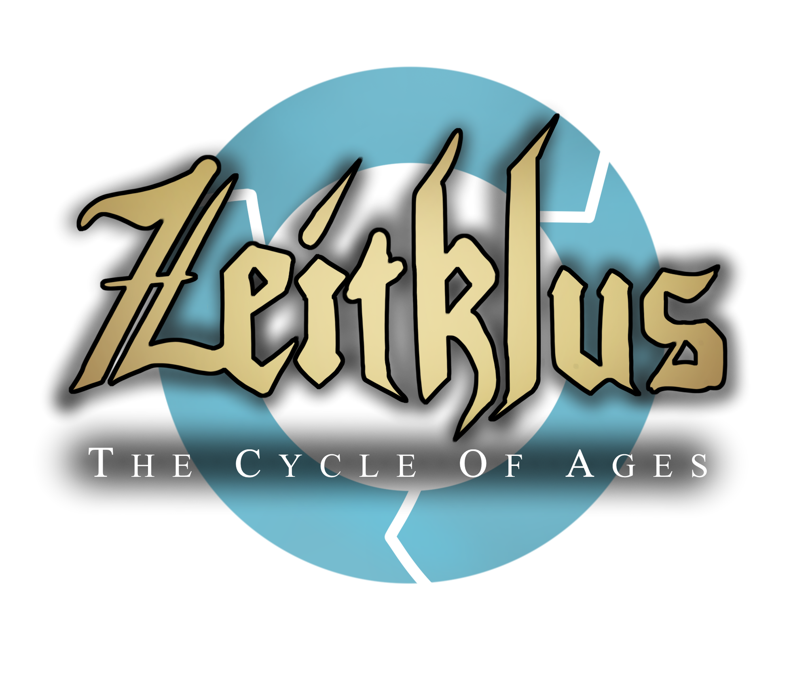
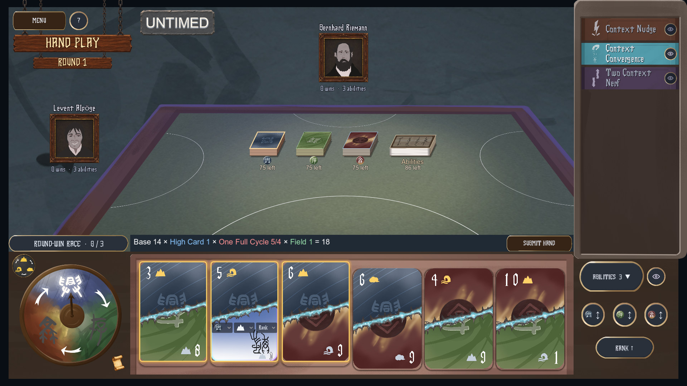

# Zeitklus: The Cycle of Ages

Zeitklus is a competitive card game where the table cycles through **Rise**, **Flourish**, and **Fall**. Each card has two halves. Flip cards to play the half that fits the current context, then build a hand that earns the most from its ranks, shape, context, and field effects. Play abilities to reshape your hand, turn the context clock, or disrupt an opponent.

## Play

- **Tutorial** teaches the controls, scoring, and abilities in a guided match.
- **Practice** is an untimed match against three bots.
- **Create Lobby** or **Join Lobby** for online play with up to four players. Share the six-character room code to invite friends. Spectators can join with the same code.

Zeitklus runs on Windows and natively on macOS. To play from source, open `project.godot` in Godot 4.7.2. Online play from source requires the [Godot WebRTC Native extension](https://github.com/godotengine/webrtc-native/releases/tag/1.2.2-stable).

## Credits

Made by **anarchira** and **akts625**. The in-game Credits list the [sound and ambience creators](assets/sound_effects/README.md), [typeface](assets/fonts/mountain_king/ATTRIBUTION.md), and tools used to make Zeitklus. The game code is available under the [MIT License](LICENSE).
